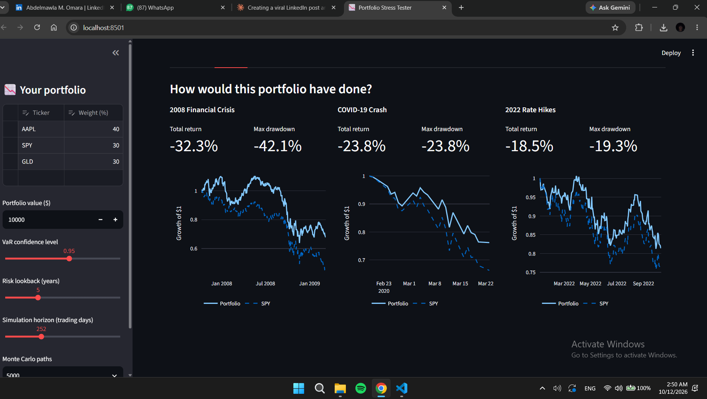

# 📉 Portfolio Stress Tester

Would your portfolio have survived 2008? Enter a few tickers and weights and this app shows how the mix behaves under stress.



## Features

- **Crisis replay:** 2008 financial crisis, COVID-19 crash and the 2022 rate hikes, compared with the S&P 500
- **Risk metrics:** annual return, volatility, Sharpe ratio, max drawdown, VaR and CVaR in plain English
- **Monte Carlo simulation:** thousands of simulated futures shown as a fan chart
- **Efficient frontier:** see where your portfolio sits versus the max-Sharpe and min-volatility mixes

## Quick start

```bash
python -m venv venv
# Windows:  venv\Scripts\activate
# Mac/Linux: source venv/bin/activate
pip install -r requirements.txt
streamlit run app.py
```

Then open the local URL Streamlit prints (usually http://localhost:8501).

## Methodology

| Metric | How it's calculated |
|---|---|
| Portfolio returns | Weighted sum of daily asset returns (daily rebalanced) |
| VaR / CVaR | Historical simulation: percentile of daily returns, and the average of returns beyond it |
| Sharpe ratio | Annualized mean return / annualized volatility (risk-free rate = 0) |
| Max drawdown | Largest peak-to-trough decline of the growth curve |
| Monte Carlo | Normally distributed daily returns using the portfolio's historical mean and volatility |
| Efficient frontier | 4,000 random long-only portfolios plus SciPy SLSQP optimization |
| Crisis replay | Tickers that didn't exist during a crisis are dropped and remaining weights rescaled |

## Limitations

- Historical data does not predict the future.
- The Monte Carlo model assumes normal returns and underestimates tail risk.
- Optimal weights are in-sample and sensitive to the lookback window.
- No transaction costs, taxes or slippage.

## Tech stack

Python, Streamlit, pandas, NumPy, SciPy, Plotly, yfinance

## Disclaimer

For educational purposes only. This is not financial advice.
